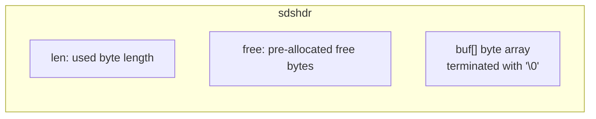
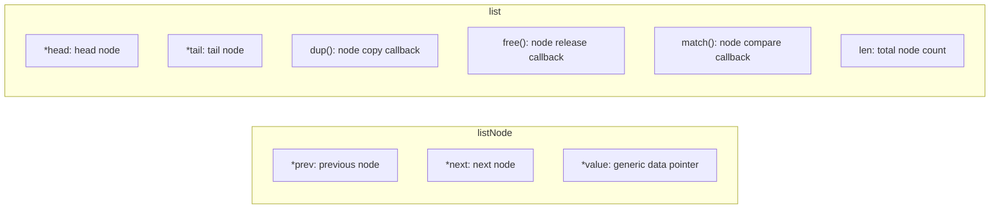
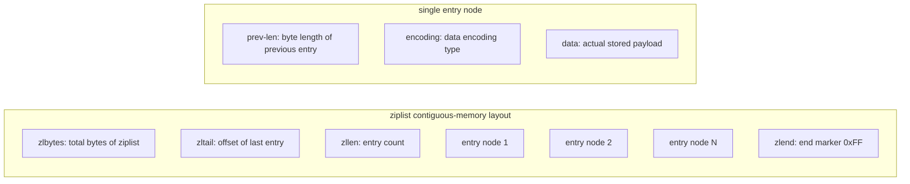
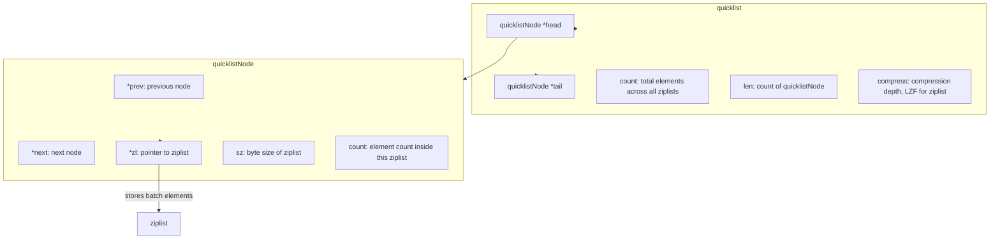
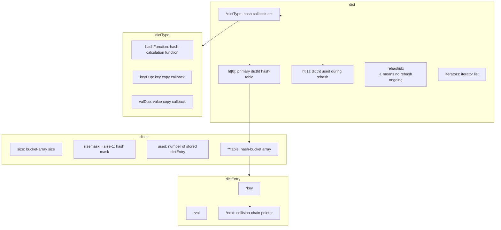
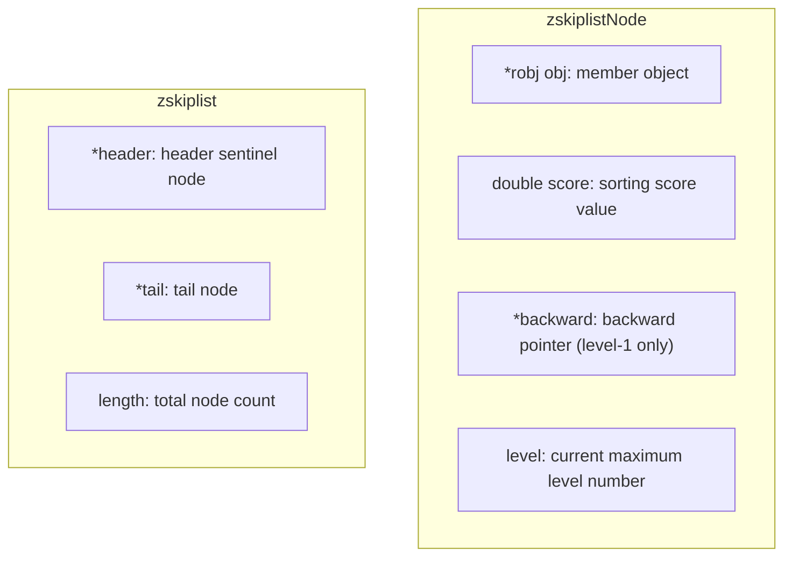
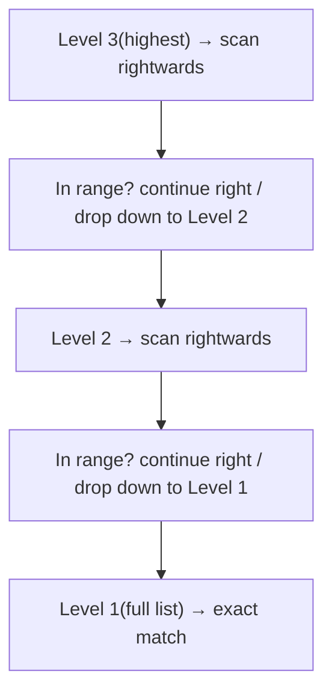
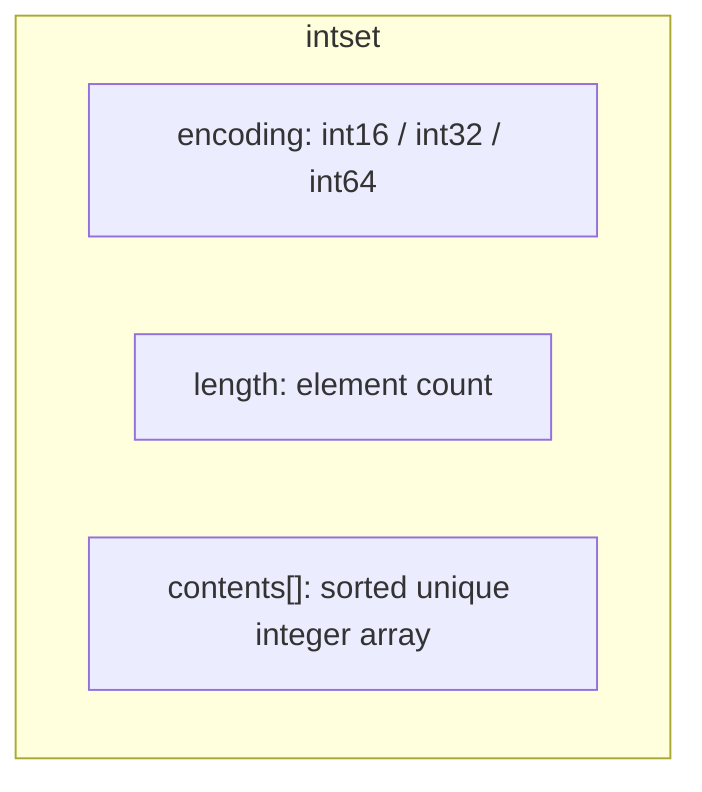

# Underlying Data Structures of Redis

REmote DIctionary Server (Redis) is an open-source in-memory key-value storage system. Written in ANSI C and licensed under BSD, it supports networking, in-memory operation and persistence.
Redis is known as a **data-structure server**. Its value supports multiple types: String, Hash(Map), List, Set, Sorted-Set.

## Table of Contents
1. [String — SDS Simple Dynamic String](#1-string--sds-simple-dynamic-string)
2. [Evolution of List: Doubly-Linked List → ziplist → quicklist](#2-evolution-of-list-doubly-linked-list--ziplist--quicklist)
3. [ziplist Compressed List](#3-ziplist-compressed-list)
4. [quicklist Details (List underlying implementation since Redis 3.2)](#4-quicklist-details-list-underlying-implementation-since-redis32)
5. [Dictionary dict — Underlying Implementation of Hash](#5-dictionary-dict--underlying-implementation-of-hash)
6. [Skiplist — Underlying Implementation of Sorted-Set(zset)](#6-skiplist--underlying-implementation-of-sorted-setzset)
7. [Summary Table of Underlying Data Structures](#7-summary-table-of-underlying-data-structures)

---

## 1 String — SDS Simple Dynamic String

Redis does not use native C strings directly. Instead, it adopts **SDS (Simple Dynamic String)**.

### SDS Structure

- **Binary-safe**: The string can contain embedded `\0` bytes. Length is determined by `len` instead of the terminating `\0`.
- Example: storing string `redis` → `len=5`, `free=5`. Total buf size = `free + len + 1`.

### 1.1 SDS Creation

Function: `sdsnewlen(const void *init, size_t initlen)`

1. Allocate memory: `sizeof(sdshdr) + initlen + 1`
2. Assign `len = initlen`, `free = 0`
3. Copy source data into buf and append `\0` at the end
4. Return pointer to buf; return NULL if memory allocation fails.

### 1.2 SDS Expansion (APPEND)

1. Calculate total length after appending content.
2. If new length < `SDS_MAX_PREALLOC`: pre-allocate **double the required memory**.
3. If new length > `SDS_MAX_PREALLOC`: pre-allocate a fixed size of `SDS_MAX_PREALLOC`.

> Advantages: reduce frequent `realloc` calls. Drawback: minor memory overhead.

### 1.3 Free Space Reclamation

When memory pressure is high, release the `free` buffer space to reduce memory footprint.

### 1.4 SDS Clear

Only reset `len=0`. **Already-allocated memory is NOT freed**, the buffer is reused.

### Advantages of SDS compared with C-style strings

1. Binary-safe, supports embedded `\0`.
2. Avoid buffer overflow; SDS APIs perform length validation.
3. Pre-allocation reduces memory-allocation frequency.
4. Get string length in **O(1)** for SDS; O(N) for C `strlen`.

---

## 2 Evolution of List: Doubly-Linked List → ziplist → quicklist

> Redis 3.0: List is implemented with native doubly-linked list.
> Redis 3.2+: List is implemented by **quicklist**, which internally uses ziplist.

### 2.1 Doubly-Linked List (Redis 3.0)

List stores strings ordered by insertion sequence. Supports `LPUSH`(head), `RPUSH`(tail), and `LRANGE` for range reading.

#### listNode & list Structure

#### Linked-List Features

1. Doubly-linked: easy access to predecessor and successor nodes.
2. Acyclic: `head->prev = NULL`, `tail->next = NULL`.
3. Generic storage via `void* value`. Callbacks customize copy, release and comparison logic.

> Drawbacks: every node carries two pointers, high memory overhead; memory is scattered and cache-unfriendly.

---

## 3 ziplist Compressed List

**ziplist: contiguous memory block for compact storage; no C pointers, saves memory.**
Use cases: List / Hash / ZSet with small element count and small element size.
All data resides in one contiguous memory segment; positions are located by offsets.

### ziplist Memory Layout

### ziplist Field Explanation

1. `zlbytes`: total bytes of ziplist, used for memory reallocation.
2. `zltail`: offset of the last entry; enables O(1) tail access.
3. `zllen`: number of entries. Once exceeding 2^16-2, full traversal is required.
4. `entry`: real-data node
   - `prev-len`: byte size of previous entry, allows backward traversal.
   - `encoding`: marks whether payload is integer or string and its size.
   - `data`: real stored content.
5. `zlend`: `0xFF`, end marker of ziplist.

### ziplist Pros & Cons

✅ Advantages
- Contiguous memory with zero pointer overhead, very memory-efficient.
- Fast tail-element access via `zltail`.

❌ Disadvantages
1. **Cascade update problem**: When one entry's size grows from <254 bytes to ≥254 bytes, the `prev-len` field of subsequent entries must be rewritten, triggering cascading updates and performance degradation.
2. Insertion / deletion triggers memory `realloc`, poor performance with large-scale data.

> ziplist is only suitable for small-size and small-count scenarios.

---

## 4 quicklist Details (List underlying implementation since Redis 3.2)

> **quicklist = doubly-linked list, each node holds a ziplist instead of a single element.**
> Solves high pointer overhead of pure linked-list and cascade-update defects of ziplist under large data.

### quicklist Structure

### quicklist Core Logic

1. quicklist is a doubly-linked list; each `quicklistNode` contains one ziplist.
2. Each ziplist has size cap controlled by config `list-max-ziplist-size`. When threshold is hit, a new quicklistNode is created and split.
3. Config `list-compress-depth`: head-side and tail-side ziplists remain uncompressed; middle-node ziplists are compressed with LZF for further memory saving.
4. `LPUSH` / `RPUSH` prefer operating head/tail ziplist; new quicklistNode is created when ziplist is full.

### quicklist Advantages

1. Combines memory efficiency of ziplist while avoiding cascade-update risk for large datasets.
2. Doubly-linked list provides efficient head-tail operations.
3. Supports LZF compression for middle nodes to reduce memory usage.

### quicklist Disadvantages

- Reading or writing compressed middle nodes requires decompression, introducing minor CPU overhead.

> Commands such as `LPUSH / RPUSH / LRANGE` are implemented on top of quicklist.

---

## 5 Dictionary dict — Underlying Implementation of Hash

Dictionary is implemented by hash-table. Key-value lookup is fast. **Chaining is used to resolve hash collision**. Core feature: **incremental rehash**.

### Structure Relationships

- `ht[0]`: used for normal read-write; `ht[1]` is only used during rehash for expansion/shrinking.
- `rehashidx`: tracks migration progress; `-1` indicates no rehash.

### 5.1 Rehash Trigger Conditions

1. First insertion into empty dictionary where hash-table `size = 0`.
2. Load factor `used/size > dict_force_resize_ratio(default=5)`, collision chains become excessively long.

> New hash-table size: at least `used*2`, and must be power-of-two.

### 5.2 Incremental Rehash Workflow

One-shot full migration would block Redis, so migration is done incrementally step-by-step:

1. Allocate memory for `ht[1]`, set `rehashidx = 0` to start rehash.
2. During rehash: **new keys are inserted only into ht[1]; look-up searches ht[0] first then ht[1] if missing**.
3. Each write / delete / lookup operation additionally migrates all entries in bucket pointed by `rehashidx` from ht[0] to ht[1], and increments `rehashidx`.
4. After ht[0] is fully migrated: release ht[0], swap ht[1] into ht[0], set `rehashidx = -1` to terminate rehash.

### Dictionary Summary

1. Resolve hash collision by separate chaining.
2. Maintain two hash-tables.
3. **Incremental rehash avoids long-time service blocking caused by massive memory movement**.

---

## 6 Skiplist — Underlying Implementation of Sorted-Set(zset)

Skiplist is adopted for zset when element count is large or member strings are long.

> zset combines two structures:
> 1. **skiplist**: responsible for range iteration and sorting by score.
> 2. **dict**: stores member-to-score mapping for O(1) score lookup by member.
>
> ziplist is used for zset when elements are few and short.

### Skiplist Features

1. Multi-level ordered linked-lists. Level-1 contains all elements; higher levels act as indexes for acceleration.
2. Any node appearing at level i must exist at level i-1.
3. Average time complexity **O(log n)**, worst-case **O(n)**.

### zskiplistNode & zskiplist Structure

### Skiplist Look-up Logic

Start from highest level, move right until target is out-of-range, drop to next lower level, repeat until level-1 for exact search.

---

## 7 Summary Table of Underlying Data Structures

| Redis exposed-type | Condition | Underlying data-structure |
|---|---|---|
| String | All scenarios | SDS |
| List | Redis < 3.2 | Doubly-linked list |
| List | Redis >= 3.2 | quicklist (inner ziplist) |
| Hash | Few small-size entries | ziplist |
| Hash | Large entry count | dict hash-table |
| ZSet (sorted-set) | Few short entries | ziplist |
| ZSet (sorted-set) | Many / long-string entries | skiplist + dict |
| Set | All-integer & small count | intset integer-set |
| Set | General strings & large count | dict hash-table |

---

## 8 Supplementary Notes

### 8.1 intset Integer-Set (Set underlying implementation)

intset is used for Set when elements are all integers and quantity is small. Integers are stored in a sorted contiguous array. Once threshold exceeded, it will convert to dict hash-table.

### 8.2 Important quicklist Configuration

- `list-max-ziplist-size`: max byte size per ziplist, controls size of each quicklistNode.
- `list-compress-depth`: compression depth; `0` disables LZF compression.

### 8.3 Take-away Summary

- **SDS**: binary-safe, O(1) length acquisition.
- **ziplist**: compact contiguous memory, vulnerable to cascade update.
- **quicklist**: ziplist + doubly-linked list, optimized List implementation.
- **dict**: separate chaining + incremental rehash.
- **skiplist**: multi-level index for O(log n) range query.
- **intset**: compact storage for integer-only Set.

> Core design philosophy: **Use compact structures (ziplist / intset) for small-volume data to save memory; use high-performance structures (dict / skiplist / quicklist) for large-volume data. Dynamically switch between structures based on data characteristics.**

