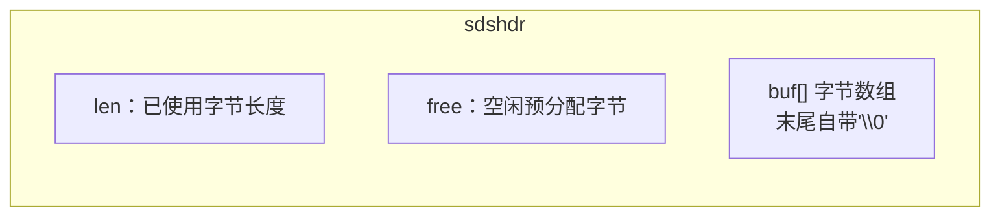
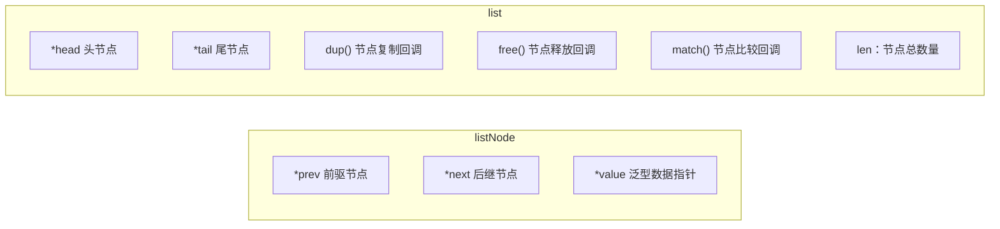
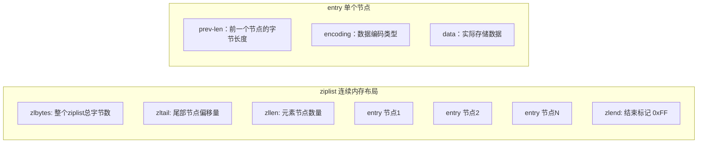
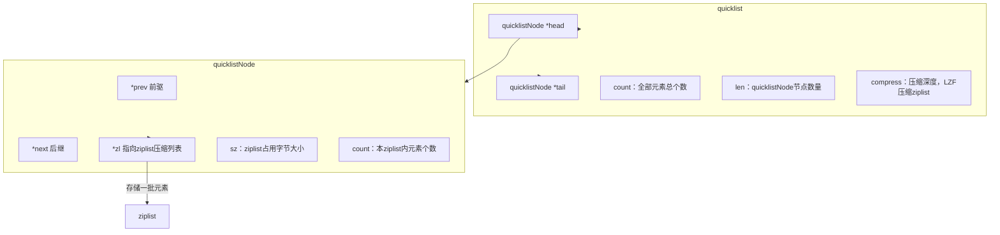
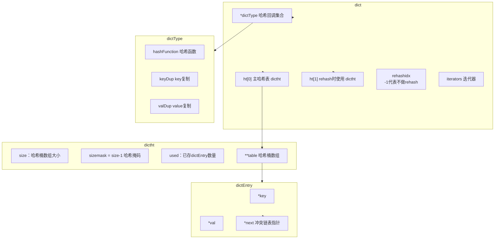
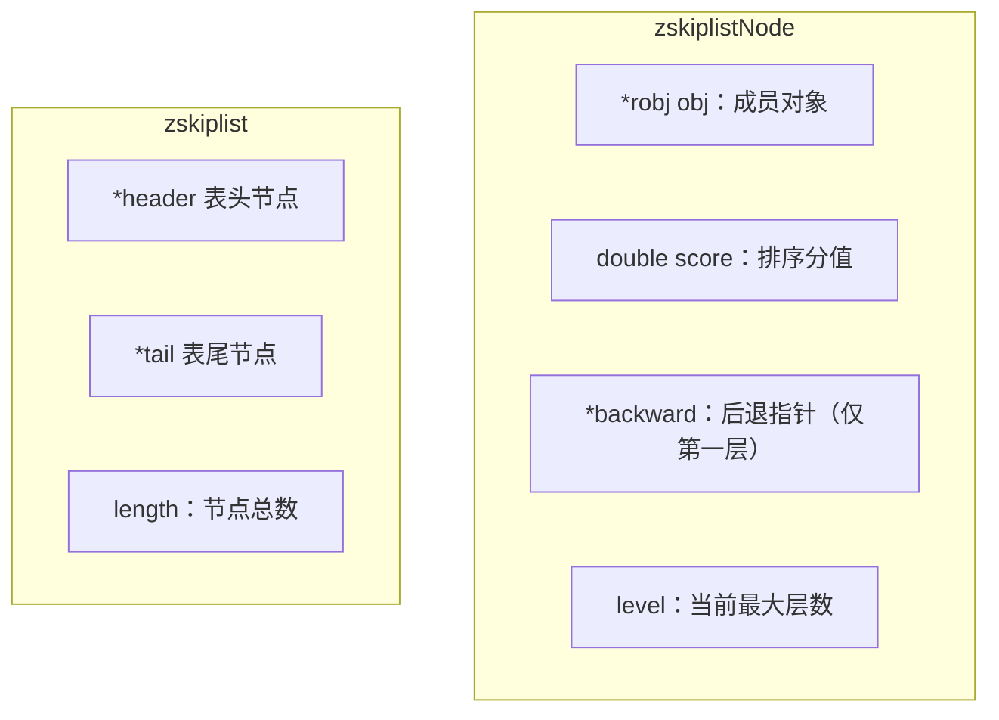
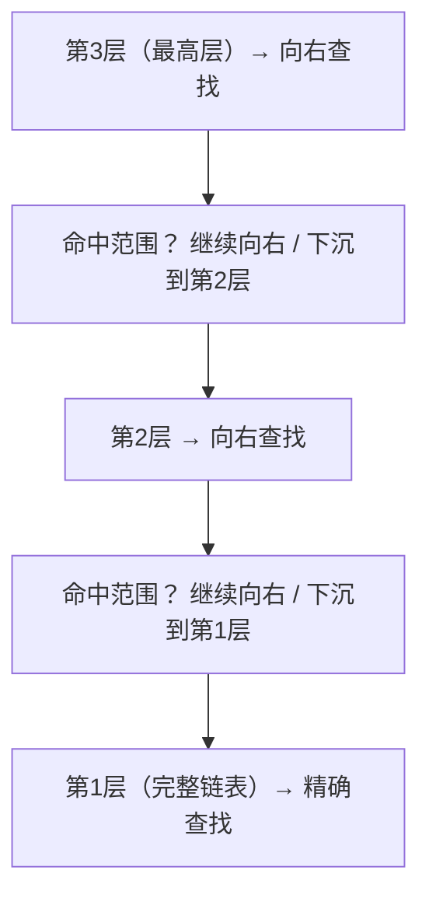
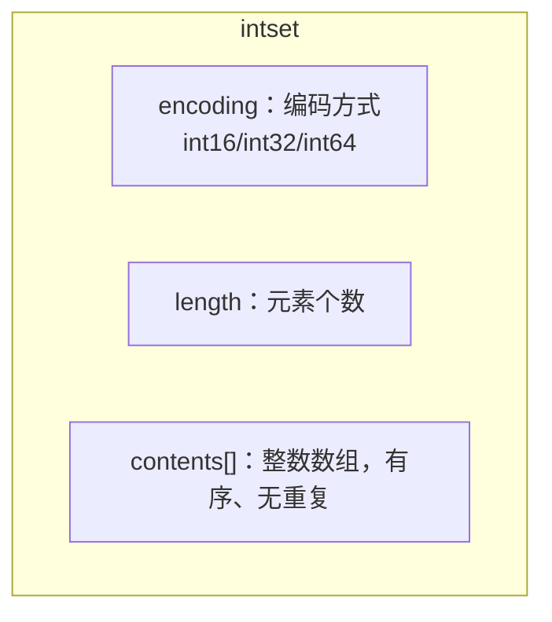

# Redis底层数据结构剖析

REmote DIctionary Server(Redis) 是一款基于内存的开源 key-value 存储系统。采用 ANSI C 编写，遵循 BSD 协议，支持网络，支持内存与持久化。
被称为**数据结构服务器**，value 支持：String、Hash(Map)、List、Set、Sorted-Set。

## 目录
1. [String 类型 — SDS 简单动态字符串](#1-string-类型--sds-简单动态字符串)
2. [List 类型演进：双向链表 → ziplist → quicklist](#2-list-类型演进双向链表--ziplist--quicklist)
3. [ziplist 压缩列表详解](#3-ziplist-压缩列表详解)
4. [quicklist 详解](#4-quicklist-详解redis32之后list底层实现)
5. [字典 dict — Hash 底层实现](#5-字典-dict--hash-底层实现)
6. [跳表 skiplist — Sorted-Set(zset)底层](#6-跳表-skiplist--sorted-setzset底层)
7. [各数据类型底层结构总览表](#7-各数据类型底层结构总览表)

---

## 1 String 类型 — SDS 简单动态字符串

Redis 底层不直接使用 C 原生字符串，而是使用 **SDS(Simple Dynamic String)**。

### SDS 结构体

- **二进制安全(binary-safe)**：字符串内部可以包含 `\0` 字符；依靠 `len` 判断字符串长度，不依赖 `\0` 结束符。
- 示例：存储字符串 `redis`，`len=5`，`free=5`，总 buf 长度 = `free + len + 1`。

### 1.1 SDS 创建

函数：`sdsnewlen(const void *init, size_t initlen)`

1. 分配内存：`sizeof(sdshdr) + initlen + 1`
2. 赋值 len = initlen，free = 0
3. 将原始数据拷贝到 buf，末尾追加 `\0`
4. 返回 buf 指针；内存分配失败返回 NULL

### 1.2 SDS 扩容（APPEND 追加）

1. 计算追加完成后总字符串长度
2. 新长度 < `SDS_MAX_PREALLOC`：预分配**双倍内存**
3. 新长度 > `SDS_MAX_PREALLOC`：额外分配固定大小 `SDS_MAX_PREALLOC`

> 优点：减少频繁 realloc 内存分配；缺点：会产生少量内存浪费。

### 1.3 SDS 空闲回收

内存紧张场景，释放 `free` 空闲内存，降低内存占用。

### 1.4 SDS 清空

仅重置 `len=0`，**不会释放已经分配的内存空间**，缓冲区复用。

### SDS 对比 C 字符串优势

1. Binary-safe，字符串允许包含 `\0`
2. 避免缓冲区溢出；SDS API 做长度校验
3. 内存预分配策略，减少内存分配次数
4. 获取字符串长度：SDS 为 **O(1)**；C 字符串 strlen 为 O(N)

---

## 2 List 类型演进：双向链表 → ziplist → quicklist

> Redis 3.0：List 底层为普通双向链表；
> Redis 3.2+：List 底层改为 **quicklist**，quicklist 内部复用 ziplist。

### 2.1 List 双向链表（Redis 3.0）

List 为按插入顺序排序的字符串双向链表；支持头部 `LPUSH`、尾部 `RPUSH`，`LRANGE` 区间读取。

#### listNode & list 结构体

#### 链表特性

1. 双向链表：快速访问前驱、后继节点
2. 无环链表：`head->prev = NULL`，`tail->next = NULL`
3. 泛型存储：`void* value` 存储任意数据；通过函数指针自定义复制、释放、比较逻辑

> **缺点**：每个节点有 prev/next 两个指针，内存开销大；节点分散不连续，对缓存不友好。

---

## 3 ziplist 压缩列表详解

**ziplist：连续内存数组，压缩存储，不使用指针，节省内存**。
适用场景：List / Hash / Zset 元素少、每个元素内容很小。
全部数据存放在一块连续内存，没有 C 指针，靠偏移量定位节点。

### ziplist 内存布局

### ziplist 字段说明

1. `zlbytes`：整个 ziplist 所占总字节，用于内存重分配
2. `zltail`：最后一个节点的偏移，支持 O(1) 访问尾部元素
3. `zllen`：节点元素个数；超过 2¹⁶-2 之后需要遍历统计
4. `entry`：实际数据节点
   - `prev-len`：上一个 entry 占用字节；可以向前回溯遍历
   - `encoding`：标记 data 是整数还是字符串、占用多大空间
   - `data`：真实内容
5. `zlend`：0xFF，ziplist 结束标识符

### ziplist 优缺点

✅ 优点
- **连续内存，无指针开销，内存占用极低**
- 尾节点可以通过 zltail 快速定位

❌ 缺点
1. **连锁更新问题**：`prev-len` 存储上一个节点长度；如果一个节点长度从小于 254 变成 >= 254，会导致后续所有 entry 的 prev-len 全部改写，产生连锁更新，性能退化
2. 插入删除需要内存 realloc，数据量大的时候效率差

> 所以 ziplist 只适合少量小元素，不适合大量数据。

---

## 4 quicklist 详解（Redis 3.2 之后 List 底层实现）

> **quicklist = 双向链表，链表的每一个节点不是单个元素，而是一块 ziplist**
> 解决纯双向链表指针开销大、ziplist 大数据下连锁更新的缺陷。

### quicklist 结构

### quicklist 核心逻辑

1. quicklist 是双向链表，每个 `quicklistNode` 存放一个 ziplist
2. 每个 ziplist 不会无限膨胀，由配置 `list-max-ziplist-size` 控制单块 ziplist 最大大小；超过阈值就分裂出新的 quicklistNode
3. `list-compress-depth` 配置：两端的 ziplist 保留不压缩，中间节点 ziplist 使用 LZF 算法压缩，进一步节省内存
4. LPUSH / RPUSH 优先操作头部/尾部 ziplist；ziplist 满了就新增链表节点

### quicklist 优势

1. 结合 ziplist 省内存，又规避 ziplist 大数据连锁更新
2. 双向链表，头尾操作高效
3. 支持 LZF 压缩中间节点，内存进一步降低

### quicklist 缺点

- 中间压缩节点读写需要解压，会带来少量 CPU 开销

> 命令：`LPUSH / RPUSH / LRANGE` 底层全部走 quicklist。

---

## 5 字典 dict — Hash 底层实现

字典基于哈希表实现，通过 key 快速查询 value；**链地址法解决哈希冲突**；核心特性：**渐进式 rehash**。

### 结构体关系

- `ht[0]`：正常业务读写；`ht[1]` 仅 rehash 扩容/缩容时使用
- `rehashidx` 记录当前 rehash 迁移进度，`-1` 表示无 rehash

### 5.1 Rehash 触发条件

1. 字典首次插入数据，哈希表 size=0
2. 负载因子 `used/size > dict_force_resize_ratio(默认5)`，冲突链表过长

> 新哈希表大小：至少 `used*2`，并且必须是 2 的整数次幂。

### 5.2 渐进式 Rehash 流程

一次性迁移全部数据会阻塞 Redis，因此分步搬迁：

1. 分配 `ht[1]` 内存，设置 `rehashidx = 0`，开启 rehash
2. rehash 期间：**新增 key 全部写入 ht[1]；查询操作优先查 ht[0]，查不到再查 ht[1]**
3. 每次执行增、删、查命令，顺带迁移 `rehashidx` 对应桶全部节点到 ht[1]，`rehashidx++`
4. `ht[0]` 全部迁移完成：释放 ht[0] 内存，将 ht[1] 切换为 ht[0]，`rehashidx = -1`，结束 rehash

### 字典小结

1. 使用链地址法解决哈希冲突
2. 维护两套哈希表
3. **渐进式 rehash，避免大内存搬迁造成服务阻塞**

---

## 6 跳表 skiplist — Sorted-Set(zset)底层

当 zset 元素数量多，或者 member 字符串很长，Redis 采用 skiplist 作为底层存储。

> zset 组合两套结构：
> 1. **skiplist**：负责按 score 做范围遍历、排序
> 2. **dict**：保存 member → score 映射，实现 O(1) 查询成员分数
>
> 元素少的时候 zset 会使用 ziplist 实现。

### 跳表特性

1. 多层有序链表；第一层包含全部节点；高层作为索引加速查找
2. 如果节点出现在第 i 层，则该节点一定存在于 i-1 层
3. 平均复杂度 **O(log n)**，最坏 **O(n)**

### zskiplistNode & zskiplist 结构体

### 跳表查找逻辑

从最高层开始向右查找，当后继节点大于目标值，则下沉下一层；直到第一层完成查找。

---

## 7 各数据类型底层结构总览表

| Redis 对外类型 | 条件 | 底层数据结构 |
|---|---|---|
| String | 全部场景 | SDS |
| List | Redis < 3.2 | 双向链表 |
| List | Redis >= 3.2 | quicklist（内部 ziplist） |
| Hash | 元素少、value 小 | ziplist |
| Hash | 元素多 | dict 哈希表 |
| ZSet (sorted-set) | 元素少、内容短 | ziplist |
| ZSet (sorted-set) | 元素多/字符串长 | skiplist + dict |
| Set | 全部整数、数量少 | intset 整数集合 |
| Set | 普通字符串、大量数据 | dict 哈希表 |

---

## 8 补充小知识点

### 8.1 intset 整数集合（Set 底层）

Set 存储全是数字并且数量不多时使用 intset：连续内存保存整数，按序排列；
数据超出阈值后转为 dict 哈希表。

### 8.2 quicklist 关键配置

- `list-max-ziplist-size`：单个 ziplist 最大字节，控制每个 quicklistNode 的大小
- `list-compress-depth`：压缩深度，0 代表不开启 LZF 压缩

### 8.3 一句话总结

- **SDS**：二进制安全 + O(1) 取长度
- **ziplist**：连续内存省空间，怕连锁更新
- **quicklist**：ziplist + 双向链表，List 的最优解
- **dict**：链地址法 + 渐进 rehash
- **skiplist**：多层索引，O(log n) 范围查询
- **intset**：纯整数 Set 的紧凑存储

> 核心思想：**小数据用紧凑结构（ziplist/intset）省内存，大数据用高效结构（dict/skiplist/quicklist）保性能**，并根据数据规模动态转换。
